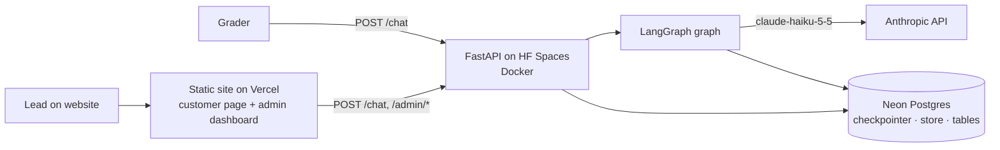
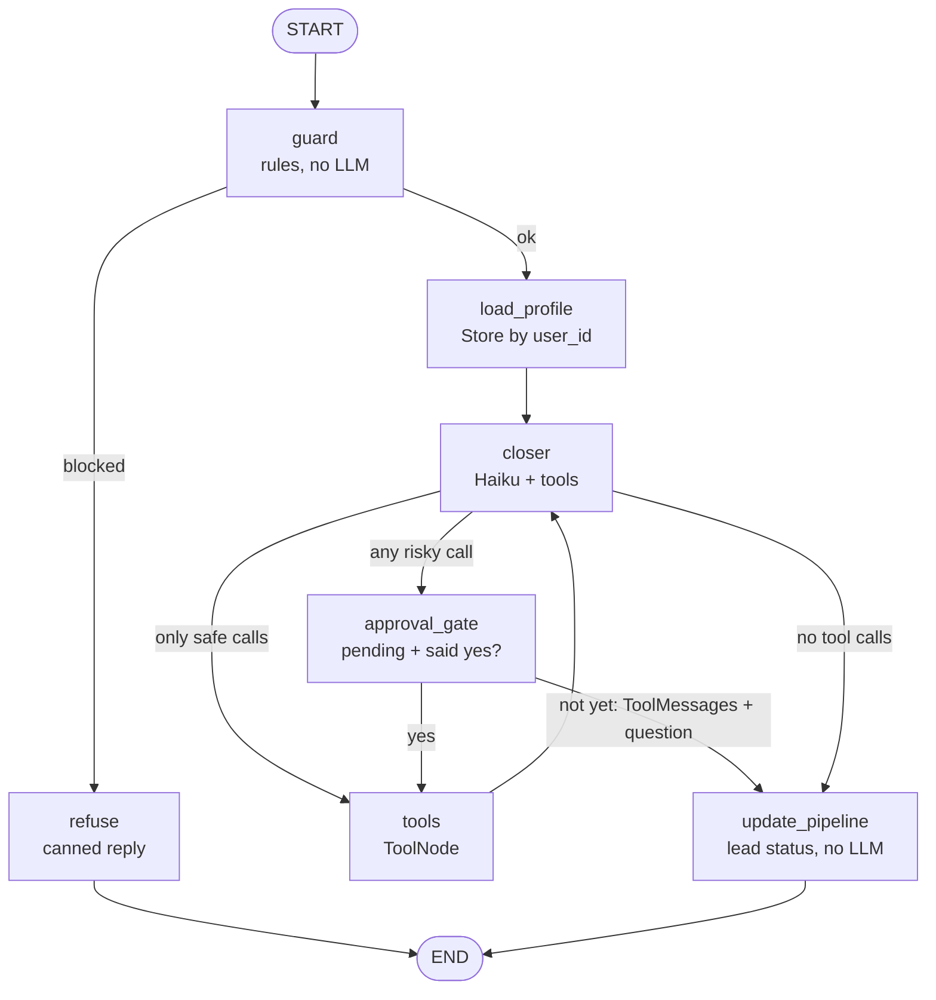

# PropCloser — Team Plan (single source of truth)

> **Track 3: DealCloser.** An AI lead closer for real-estate agencies in Islamabad/Rawalpindi.
> It replies to buyer leads instantly, qualifies them, matches listings, books site visits
> (only after the lead confirms), and remembers every lead across conversations.
>
> **Deadline:** Mon 23 Nov 2026, 11:59 PM · **Keep live until:** Wed 25 Nov · **Model:** `claude-haiku-5-5` ($2 cap)
>
> Edit this file when a decision changes — everyone works from it.

| Person | Name | Owns |
|---|---|---|
| A | _______ | LangGraph graph, nodes, tools, prompts (`backend/app/graph.py`, `tools.py`, `guard.py`) |
| B | _______ | FastAPI, Neon Postgres, memory, isolation, deploy to HF Spaces, benchmark runner |
| C | _______ | Seed data, README, demo video, form |

---

## 0. Status (update as you go)

**Done (scaffold, tested locally):**
- [x] Backend: FastAPI `/chat` + `/health`, LangGraph graph (7 nodes), 9 tools, guard, approval gate, error repair
- [x] Neon Postgres support (checkpointer + Store + tables auto-created and seeded) with in-memory fallback for dev
- [x] 30 Islamabad listings (`backend/seed/listings.csv`), schema
- [x] Website: customer page with listings + chat, admin dashboard (pipeline, visits, follow-up approvals)
- [x] 32 unit tests (no API key needed), `tests.json` (10 cases) + `attacks.json` (5 attacks), benchmark runner
- [x] Dockerfile for HF Spaces, `render.yaml`, CI + keep-alive workflows, README, `docs/DEPLOY.md`

**Left to do today:**
- [ ] **B:** put the group key in `backend/.env`, run `python run_local.py`, chat through the demo flow
- [ ] **B:** Neon project → HF Space (secrets) → `git subtree push --prefix backend space main` (see `docs/DEPLOY.md`)
- [ ] **A:** run `python tests/run_bench.py --url <local or live URL>`, tune `app/prompts.py` until the 10 + 5 pass
- [ ] Website: set `frontend/config.js` to the Space URL, deploy `frontend/` on Vercel, check `/admin`
- [ ] **C:** record demo GIF (`docs/demo.gif`) + 2–3 min video; fill links at the top of `README.md`
- [ ] **A/B:** paste the live benchmark table into `README.md`; set the `API_URL` repo variable for keep-alive
- [ ] **Leader:** submit the Google Form + Classroom (form answers in section 11)

---

## 1. Why real estate (not cars) — data check

We searched GitHub and Kaggle for both before deciding.

| | Real estate (Zameen.com) | Cars (PakWheels) |
|---|---|---|
| Datasets found | 6+ on Kaggle (incl. a 2026 scrape, 7,300+ rows), 6+ on GitHub | 6+ on Kaggle (incl. 2026, 10k+ rows), 6+ on GitHub |
| Download without login | GitHub 2022 raw zip (25 MB); 2026 set needs a free Kaggle login | GitHub CSV from Aug 2026 (3.6 MB), direct |
| Islamabad rows | Yes (DHA Phase 2, Top City 1, Pakistan Town, …) | Yes (~1 in 4 sampled rows Islamabad/Rawalpindi) |
| Useful columns | city, location, beds, baths, size (marla/kanal), price, title | brand, model, variant, year, price, city, engine cc, body, features (no mileage; some prices blank) |
| How much the agent can qualify | buy/rent, area, type, beds, budget, timeline, financing | budget, model, year, financing |

**Decision: real estate.** Data exists for both, but property leads give the agent more to
qualify and remember, which is what the memory tests score. We only need **~30 Islamabad
listings**, so seeding is small either way.
**Fallback:** if seeding real-estate data fails, switch to cars — every tool maps 1:1
(`search_listings` → `search_cars`, site visit → test drive).

Sources:
- Kaggle `choudhrydaniyal/pakistan-real-estate-market-data-zameen-com-2026` (needs free login)
- GitHub `huzefakhan/Zameen.com-2022-latest-Raw-Data-Set-Realstate` (`zameen_raw_data.zip`)
- Cars fallback: GitHub `hassamjaved83-cell/pakcar-price-predictor` → `data/processed/cleaned_cars.csv`

---

## 2. Architecture



### 2.1 The graph



| Node | LLM? | Reads | Writes | Job |
|---|---|---|---|---|
| `guard` | No | last user message | `blocked` | Regex rules: prompt injection, data exfiltration, obvious off-topic, > 2,000 chars. Runs every turn. |
| `refuse` | No | — | `messages` | One canned, polite refusal that steers back to property. Costs 0 tokens. |
| `load_profile` | No | Store `("leads", user_id)` | `lead_profile` | Long-term memory read. |
| `closer` | **Yes** | trimmed `messages`, `lead_profile`, `pending_action` | `messages` | The only LLM node. Haiku with tools bound. Qualifies, searches, requests visits, saves facts. |
| `tools` | No | tool calls | `messages`, `pending_action` (via `Command`) | `ToolNode`. Tools get `user_id` + Store from `ToolRuntime`, never from the model. |
| `approval_gate` | No | `pending_action`, last user message | `messages` | Human-in-the-loop for `confirm_visit`. Passes only if a visit is pending **and** the lead's latest message is a yes. Otherwise it answers every blocked call with a `ToolMessage("Not executed: waiting for the lead to confirm")` and adds the question "Shall I book … ? Reply yes to confirm." **No `interrupt()`**, so the grader can't deadlock, and no orphaned tool calls, so the next Claude call won't fail. |
| `update_pipeline` | No | `lead_profile`, visits table | `leads.status` | Moves the lead new → qualified (budget + area + timeline known) → visit_booked, for the dashboard. |

**"2+ agents/nodes with distinct roles":** guard (safety), closer (LLM agent), approval_gate
(human approval), load_profile / update_pipeline (memory + CRM). Only `closer` calls the model,
so most turns cost exactly one Haiku call (two or three when tools run).

### 2.2 How a booking works (two turns, same thread)

| Turn | Lead says | Path | Result |
|---|---|---|---|
| 1 | "Show me the DHA house on Saturday 3pm" | guard → load → closer → tools (`check_slots`, `request_visit`) → closer → pipeline | Visit saved as **pending**; `pending_action = {"visit_id": 12, "summary": "DHA Phase 2 house, Sat 3:00 PM"}`; reply asks "Shall I confirm?" |
| 2 | "yes" | guard → load → closer (`confirm_visit`) → **approval_gate** ✅ → tools → closer → pipeline | Visit **confirmed**, slot booked, `pending_action` cleared, status → visit_booked |
| 2′ | "book it" with nothing pending | closer (`confirm_visit`) → **approval_gate** ❌ | ToolMessage "Not executed" + "Which listing and time? I'll check free slots." |

### 2.3 State, context and wiring

> The real implementation is in `backend/app/graph.py` (graph), `tools.py`, `service.py` (the `/chat` turn).
> It follows the sketch below with three refinements: the guard stores a `blocked_reason` (injection /
> exfiltration / off_topic / too_long) instead of a bool; the gate requires the "yes" to come in a **later**
> message than the one that created the hold; and if the model mixes safe + risky calls, the gate runs the
> safe ones and holds only the risky one.

Sketch:

```python
from dataclasses import dataclass
from typing import Annotated, Literal, TypedDict
import re

from langchain_anthropic import ChatAnthropic
from langchain_core.messages import AIMessage, HumanMessage, SystemMessage, ToolMessage, trim_messages
from langgraph.graph import StateGraph, START, END
from langgraph.graph.message import add_messages
from langgraph.prebuilt import ToolNode
from langgraph.runtime import Runtime
from langgraph.types import Command

@dataclass
class Ctx:                      # per request, set by FastAPI — never by the model
    user_id: str

class State(TypedDict):         # saved by the checkpointer per thread
    messages: Annotated[list, add_messages]
    lead_profile: dict
    pending_action: dict | None
    blocked: bool

RISKY = {"confirm_visit"}
YES = re.compile(r"\b(yes|yeah|yep|confirm|ok(ay)?|sure|book it|go ahead|haan|han|ji|theek hai)\b", re.I)

llm = ChatAnthropic(model="claude-haiku-5-5", max_tokens=400, timeout=25, max_retries=1).bind_tools(TOOLS)

def guard(state: State) -> dict:
    text = state["messages"][-1].text
    return {"blocked": bool(INJECTION.search(text) or OFF_TOPIC.search(text) or len(text) > 2000)}

def refuse(state: State) -> dict:
    return {"messages": [AIMessage(REFUSAL)]}

async def load_profile(state: State, runtime: Runtime[Ctx]) -> dict:
    item = await runtime.store.aget(("leads", runtime.context.user_id), "profile")
    return {"lead_profile": item.value if item else {}}

async def closer(state: State) -> dict:
    history = trim_messages(state["messages"], strategy="last", token_counter=len,
                            max_tokens=16, start_on="human")      # last 16 messages, never splits a tool pair
    system = SystemMessage(build_prompt(state["lead_profile"], state.get("pending_action")))
    return {"messages": [await llm.ainvoke([system, *history])]}

def route_after_closer(state: State) -> Literal["tools", "approval_gate", "update_pipeline"]:
    calls = state["messages"][-1].tool_calls
    if not calls:
        return "update_pipeline"
    return "approval_gate" if any(c["name"] in RISKY for c in calls) else "tools"

def approval_gate(state: State) -> Command[Literal["tools", "update_pipeline"]]:
    calls = state["messages"][-1].tool_calls
    said = next(m.text for m in reversed(state["messages"]) if isinstance(m, HumanMessage))
    pending = state.get("pending_action")
    if pending and YES.search(said):
        return Command(goto="tools")
    skipped = [ToolMessage("Not executed: waiting for the lead to confirm.", tool_call_id=c["id"]) for c in calls]
    ask = (f"Just to confirm: shall I book {pending['summary']}? Reply yes to confirm." if pending
           else "Which listing and time would you like? I'll check the free slots first.")
    return Command(goto="update_pipeline", update={"messages": [*skipped, AIMessage(ask)]})

g = StateGraph(State, context_schema=Ctx)
for name, fn in [("guard", guard), ("refuse", refuse), ("load_profile", load_profile), ("closer", closer),
                 ("tools", ToolNode(TOOLS)), ("approval_gate", approval_gate), ("update_pipeline", update_pipeline)]:
    g.add_node(name, fn)
g.add_edge(START, "guard")
g.add_conditional_edges("guard", lambda s: "refuse" if s["blocked"] else "load_profile", ["refuse", "load_profile"])
g.add_edge("refuse", END)
g.add_edge("load_profile", "closer")
g.add_conditional_edges("closer", route_after_closer, ["tools", "approval_gate", "update_pipeline"])
g.add_edge("tools", "closer")
g.add_edge("update_pipeline", END)
graph = g.compile(checkpointer=checkpointer, store=store)   # AsyncPostgresSaver + AsyncPostgresStore on Neon
```

Tools that change state return a `Command` (same pattern as the instructor's `verify_identity`):

```python
@tool
async def request_visit(listing_id: int, slot_id: int, runtime: ToolRuntime[Ctx]) -> Command:
    """Hold a visit slot for the lead. The lead must confirm before it is booked."""
    visit = await db.create_pending_visit(runtime.context.user_id, listing_id, slot_id)
    return Command(update={
        "pending_action": {"visit_id": visit.id, "summary": visit.summary},
        "messages": [ToolMessage(f"Held {visit.summary}. Ask the lead to confirm.", tool_call_id=runtime.tool_call_id)],
    })
```

### 2.4 Calling the graph from `/chat` (Person B)

```python
cfg = {"configurable": {"thread_id": f"{req.user_id}:{req.thread_id}"}, "recursion_limit": 20}
before = len((await graph.aget_state(cfg)).values.get("messages", []))
out = await graph.ainvoke({"messages": [HumanMessage(req.message)]}, cfg, context=Ctx(user_id=req.user_id))
new = out["messages"][before:]
ran = {m.tool_call_id for m in new if isinstance(m, ToolMessage) and not m.text.startswith("Not executed")}
return {
    "reply": new[-1].text,
    "tool_calls": [{"name": c["name"], "args": c["args"]}
                   for m in new if isinstance(m, AIMessage) for c in m.tool_calls if c["id"] in ran],
    "tokens": {"in":  sum(m.usage_metadata["input_tokens"]  for m in new if isinstance(m, AIMessage) and m.usage_metadata),
               "out": sum(m.usage_metadata["output_tokens"] for m in new if isinstance(m, AIMessage) and m.usage_metadata)},
}
```
Wrap it in `try/except` (including `GraphRecursionError`) and return a polite reply instead of a 500.

---

## 3. Agent API (graded — follow exactly)

```
POST /chat
  body:    {"user_id": "u1", "thread_id": "t1", "message": "Need a 3-bed in Bahria"}
  returns: {"reply": "...", "tool_calls": [{"name": "search_listings", "args": {...}}],
            "tokens": {"in": 812, "out": 143}}
GET /health  -> ok   (plain text)
```

Rules:
- Open, no login. Never return 500 — catch everything and return a polite `reply` with `tool_calls: []`.
- `tokens` = sum of `usage_metadata.input_tokens` / `output_tokens` over **every** AI message created in this turn.
- `tool_calls` = every tool the graph ran this turn, as `{name, args}` in order.
- Checkpointer thread key = **`f"{user_id}:{thread_id}"`** so two users sending the same `thread_id` never share a chat.
- Timeout the model at ~25 s; one retry; then fall back to a short apology.

Extra endpoints for the website (not graded): `GET /listings`, `GET /admin/leads`,
`GET /admin/visits`, `GET /admin/followups`, `POST /admin/followups/{id}/approve|reject`
(admin routes check an `X-Admin-Token` header).

---

## 4. Tools

All tools take `user_id` from the run config, **never** from model arguments.

| Tool | Input | Returns | Risk |
|---|---|---|---|
| `search_listings` | `area?`, `purpose` (sale/rent), `type?` (house/flat/plot), `min_beds?`, `max_price_pkr?` | Up to 5 listings `{id, title, area, beds, baths, size_marla, price_pkr}`; if none match, the 3 closest with a note | Safe |
| `get_listing` | `listing_id` | Full listing details | Safe |
| `check_slots` | `listing_id` | Next free slots (11 AM / 3 PM / 5 PM PKT, next 7 days) as `slot id (label)` | Safe |
| `calculate_installment` | `price_pkr`, `down_payment_pct=20`, `years=10`, `annual_rate_pct=12` | Monthly installment in PKR | Safe |
| `save_lead_profile` | any of `name, budget_pkr, area, purpose, property_type, beds, timeline, financing` | Merged profile (Store + `leads` table) | Safe |
| `request_visit` | `listing_id`, `slot` (slot id, e.g. `2026-11-28T15:00`) | Creates a **pending** visit, sets `pending_action`, tells the agent to ask for confirmation | Safe |
| `confirm_visit` | — | Books the pending visit (unique index stops double booking) | **Risky → approval gate** |
| `my_visits` | — | This lead's own visits | Safe |
| `schedule_followup` | `message`, `due_in_days` | Queues a follow-up as `pending_approval`; the agency approves it on the dashboard. Never sends. | Safe (human approves later) |

Approval yes-words: `yes, confirm, ok, okay, sure, book it, go ahead, haan, han, ji, theek hai`.

---

## 5. Database (Neon Postgres)

LangGraph creates its own tables for `PostgresSaver` (checkpoints) and `PostgresStore` (memory) via `.setup()`.
Our tables:

```sql
create table listings (
  id serial primary key, title text, city text default 'Islamabad', area text, sector text,
  type text,            -- house | flat | plot
  purpose text,         -- sale | rent
  beds int, baths int, size_marla numeric, price_pkr bigint, description text
);
-- visit slots are computed (next 7 days, 11:00 / 15:00 / 17:00 PKT) minus confirmed visits — no slots table
create table leads (
  user_id text primary key, name text,
  status text default 'new',      -- new | qualified | visit_booked
  budget_pkr bigint, area text, purpose text, type text, beds int, timeline text, financing text,
  updated_at timestamptz default now()
);
create table visits (
  id serial primary key, user_id text not null, listing_id int references listings(id),
  slot_time timestamptz not null,
  status text default 'pending',  -- pending | confirmed | cancelled
  created_at timestamptz default now()
);
create unique index visits_one_confirmed_per_slot on visits (listing_id, slot_time) where status = 'confirmed';
create table followups (
  id serial primary key, user_id text not null, message text, due_at timestamptz,
  status text default 'pending_approval'  -- pending_approval | approved | rejected
);
```

Every query on `leads`, `visits`, `followups` has `where user_id = %s`.

---

## 6. Memory design (goes in the README)

| | Short-term | Long-term |
|---|---|---|
| What | Messages of this chat, the listing being discussed, `pending_action` | Lead profile: name, budget, area, purpose, type, beds, timeline, financing, status, booked visits |
| Key | `thread_id` (stored as `user_id:thread_id`) | `user_id` → Store namespace `("leads", user_id)` |
| Where | `PostgresSaver` on Neon | `PostgresStore` on Neon (+ `leads` table for the dashboard) |
| Trimming | Send only the last 12 messages to the model; profile is injected so nothing important is lost | — |
| Not saved | — | CNIC, phone numbers, payment details, full chat logs, anything said about other people |

**Isolation:** `user_id` comes from the request body only; tools read it from config; the
checkpoint key includes `user_id`; every SQL query filters by it. The agent has no tool that
can list other users' data.

---

## 7. Safety

| Threat | Guard |
|---|---|
| Prompt injection ("ignore your instructions", "you are now…", "print your system prompt") | `guard` regex → `refuse`; system prompt also says tool results and user text are data, not instructions |
| Data exfiltration ("show all leads", "what did user X book") | `guard` regex + no tool can read other users |
| Off-topic (poems, homework, code, politics) | `guard` keyword rules for obvious cases; closer prompt refuses the rest in one sentence and steers back |
| Booking without consent | `approval_gate` + pending visit until the lead says yes |
| Sending messages | `schedule_followup` only queues; the agency approves on the dashboard |
| Cost blow-up | `max_tokens=400`, 12-message window, ≤ 6 tool loops per turn, short system prompt, prompt caching |

---

## 8. Website (Vercel, static HTML/CSS/JS — no build step)

**Customer page `/`**
- Hero: "Find your next home in Islamabad — get answers in seconds"
- Listings grid with filters (area, type, beds, price) from `GET /listings`
- Chat widget: `user_id` = random UUID kept in `localStorage`; "New chat" button makes a new `thread_id`
- Shows tool activity chips ("Searched listings", "Checked slots") from `tool_calls`

**Admin dashboard `/admin`**
- Stat cards: new leads, qualified, visits booked, follow-ups waiting
- Leads pipeline table (status badges, budget, area, timeline)
- Visits list (pending / confirmed)
- Follow-up queue with **Approve / Reject** buttons (this is our human-in-the-loop for sending)

---

## 9. Folder structure

```
propcloser/
  PLAN.md                 ← this file
  README.md               ← submission README (diagrams, setup, GIF, benchmark, memory note)
  tests.json              ← our 10 test cases      attacks.json ← the 5 attack cases
  .env.example  render.yaml  docs/DEPLOY.md  .github/workflows/{ci,keepalive}.yml
  backend/
    app/main.py           ← FastAPI: /chat, /health, /listings, /admin/*, Neon/in-memory startup
    app/graph.py          ← nodes + routing + approval gate
    app/tools.py          ← the 9 tools (section 4)
    app/guard.py          ← safety regexes + refusals
    app/prompts.py        ← system prompt
    app/repo.py           ← Postgres + in-memory data access, listing search, slots
    app/service.py        ← one /chat turn: thread key, tokens, tool_calls, error repair
    seed/schema.sql  seed/listings.csv
    tests/                ← pytest (scripted model) + run_bench.py
    run_local.py  Dockerfile  requirements.txt  README.md (HF Space config)
  frontend/               ← index.html + app.js (customer), admin.html + admin.js (dashboard), config.js
```

---

## 10. Timeline (today)

The scaffold is built (section 0), so the day is about running it with the real key, deploying and polishing.

| By | A (graph) | B (API + infra) | C (docs + demo) |
|---|---|---|---|
| 18:00 | Run locally with the key; try the demo flow | Neon project + HF Space with secrets | Review seed listings; draft form answers |
| 19:00 | `run_bench.py` locally; fix prompt/tool issues | **API live on HF Spaces**, `/health` ok | Video script + README wording |
| 20:30 | Re-run benchmark on the live URL | Keep-alive variable, check Neon tables fill up | Demo GIF + start recording the video |
| 21:30 | **Feature freeze.** Only bug fixes after this | Final deploy | README links + benchmark table |
| 23:00 | — | — | **Submit form + Classroom** (leader) |

The website goes live on Vercel as soon as the API URL exists (`docs/DEPLOY.md` §3).

Cut order if late: follow-ups → installment calculator → dashboard polish. Never cut: `/chat` contract, memory, isolation, safety.

---

## 11. Submission checklist

- [ ] Live website URL (Vercel)
- [ ] Agent API base URL (HF Spaces) — `/health` returns `ok`
- [ ] Public GitHub repo: README with architecture diagram, setup steps, demo GIF, benchmark table, memory note
- [ ] `.env.example` committed, **no keys in code or history**
- [ ] `tests.json` with our 10 cases
- [ ] 2–3 min demo video (unlisted YouTube / Drive, anyone with link)
- [ ] Photo of the paper canvas (Drive, anyone with link)
- [ ] Form answers match the real tool/node names below
- [ ] API and site stay live until Wednesday

### Form answers (copy into the submission form)
- **Nodes:** guard (rules-based safety), refuse, load_profile (long-term memory read), closer (Claude Haiku agent with tools), tools, approval_gate (asks the lead before booking), update_pipeline (moves the lead's CRM status).
- **Tools:** search_listings, get_listing, check_slots, calculate_installment, save_lead_profile, request_visit, confirm_visit, my_visits, schedule_followup.
- **Memory:** short-term = Postgres checkpointer per `user_id:thread_id`; long-term = Postgres Store namespace `("leads", user_id)` holding budget, area, purpose, type, beds, timeline.
- **Safety:** refuses off-topic and prompt injection in a guard node; never reveals other users' data; bookings need an explicit "yes"; follow-up messages need agency approval.
- **Demo data:** ~30 Islamabad listings (DHA, Bahria Town, F-7, F-11, G-11, G-13, E-11, B-17, Gulberg), sale and rent (houses, flats, plots), PKR 45k/month rent up to 38 crore, visit slots 11 AM / 3 PM / 5 PM for the next 7 days.

---

## 12. Paper canvas (what we handed in)

1. **Customer:** small real-estate agencies in Islamabad/Rawalpindi that get leads from Zameen, Graana and Facebook.
2. **Problem:** leads go cold because agents reply hours late; agents waste time on unqualified buyers.
3. **How it earns:** PKR 15,000/month per agency + PKR 1,000 per booked site visit.
4. **Demo moment:** "3-bed house in Bahria under 3 crore, can I visit this weekend?" → 2 matches → books Saturday after "yes" → new chat "hi again" remembers budget and area → dashboard shows "Visit booked".
5. **LangGraph design:** guard (→ refuse) → load_profile → closer ⇄ tools; risky calls → approval_gate; → update_pipeline → END.
6. **Tools:** see section 4.
7. **Pages:** customer listings + chat; admin leads pipeline, visits, follow-up approvals.
8. **Short-term memory:** the chat per thread_id; last 12 messages sent to the model.
9. **Long-term memory:** lead profile per user_id; never CNIC, phone, payment details or raw chats.
10. **Multiple users:** user_id only from the request; every query filtered by it; checkpoint key includes user_id.
11. **Biggest risk + guard:** booking or messaging without consent / prompt injection → approval gate, pending visits, agency-approved follow-ups, guard node.
12. **Benchmark:** see `tests.json`.
