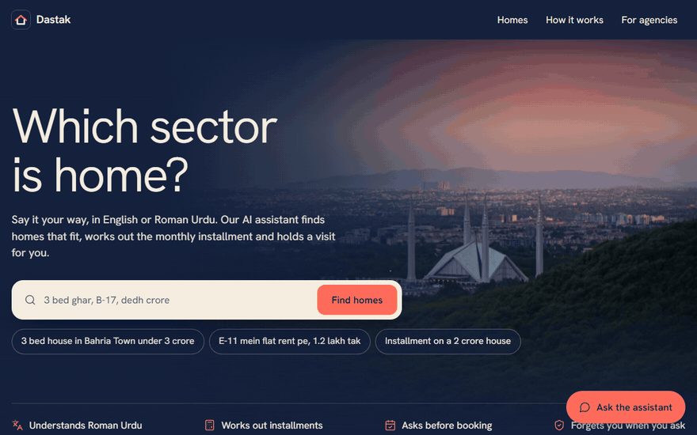
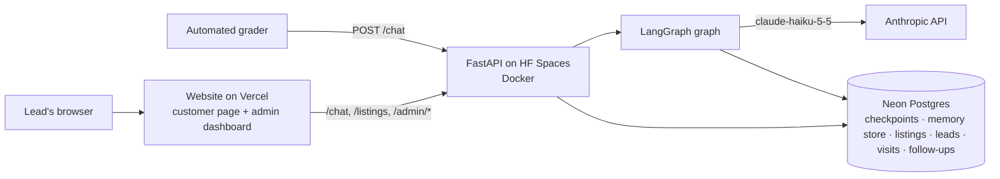
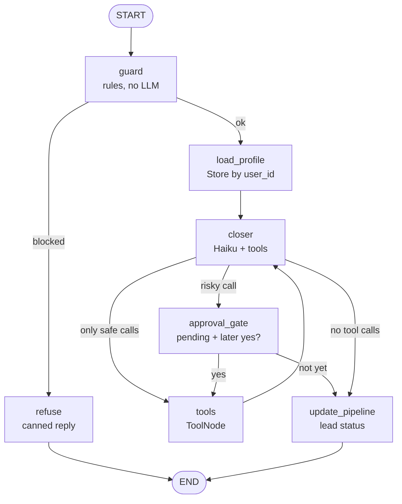

# 🏠 PropCloser — AI lead closer for Islamabad real estate

**Track 3 · DealCloser** — AI-4016 Agentic AI, *Design to Production* hackathon (FAST NUCES Islamabad).

Property agencies lose buyers because nobody replies for hours. PropCloser answers every lead in
seconds, qualifies them (buy/rent, area, budget, beds, timeline), shows matching listings, estimates
installments and books site visits — **only after the lead confirms** — and remembers each lead
across conversations. The agency watches its pipeline and approves follow-ups on a dashboard.

| | Link |
|---|---|
| 🌐 Website (customer page + `/admin` dashboard) | `https://<your-vercel-app>.vercel.app` |
| 🤖 Agent API | `https://<hf-username>-propcloser-api.hf.space` (`/health`, `/chat`, `/docs`) |
| 🎬 Demo video (2–3 min) | `<YouTube unlisted / Drive link>` |
| 📝 Paper canvas photo | `<Drive link>` |


<sub>Record a GIF of the demo flow (e.g. ScreenToGif / Kap) and save it as `docs/demo.gif`.</sub>

---

## Business case

- **Customer:** small and mid-size real-estate agencies in Islamabad/Rawalpindi that get leads from Zameen, Graana and Facebook.
- **Problem:** leads go cold within hours; agents waste time on unqualified buyers.
- **Pricing:** PKR 15,000 / month per agency + PKR 1,000 per booked site visit.
- **Why it wins:** instant replies in English or Roman Urdu, a qualified pipeline, and visits booked while the agent sleeps.

## Architecture



### LangGraph design



| Node | LLM? | Role |
|---|---|---|
| `guard` | No | Blocks prompt injection, data exfiltration, obvious off-topic and over-long messages (regex rules). |
| `refuse` | No | Fixed polite refusal that steers back to property. **0 tokens.** |
| `load_profile` | No | Reads the lead's long-term profile from the Store (`("leads", user_id)`). |
| `closer` | **Yes** | The sales agent: Claude Haiku with 9 tools. The only node that calls the model. |
| `tools` | No | LangGraph `ToolNode`; tools take `user_id` from the run context, never from the model. |
| `approval_gate` | No | Human-in-the-loop: `confirm_visit` runs only if a visit is pending **and** the lead says yes in a later message. Never uses `interrupt()`, so the automated grader can't deadlock. |
| `update_pipeline` | No | Moves the lead new → qualified → visit booked for the dashboard. |

### Tools

| Tool | What it does | Risk |
|---|---|---|
| `search_listings` | Filters 30 Islamabad listings by purpose, area, type, beds, budget; returns the closest options if nothing matches | safe |
| `get_listing` | Full details of one listing | safe |
| `check_slots` | Free visit slots for the next 7 days | safe |
| `calculate_installment` | Monthly installment (amortisation formula) | safe |
| `save_lead_profile` | Writes budget/area/beds/timeline… to long-term memory + CRM | safe |
| `request_visit` | Holds a slot as **pending** | safe |
| `confirm_visit` | Books the pending visit | **risky → approval_gate** |
| `my_visits` | The lead's own visits | safe |
| `schedule_followup` | Queues a follow-up for the agency to approve — never sends | safe (human approves) |

## Memory design

| | Short-term | Long-term |
|---|---|---|
| **What** | The messages of this chat, the visit being held (`pending_action`) | Lead profile: name, budget, area, buy/rent, type, beds, timeline, financing, booked visits |
| **Keyed by** | `thread_id` — stored as `user_id:thread_id` | `user_id` — Store namespace `("leads", user_id)` |
| **Where** | LangGraph `AsyncPostgresSaver` on Neon | LangGraph `AsyncPostgresStore` on Neon (+ `leads` table for the dashboard) |
| **Trimming** | Only the last ~16 messages go to the model, always cut at a user message so tool calls are never split; the profile is injected, so nothing important is lost | — |
| **Not saved** | — | Phone numbers, CNIC, payment details, raw chat logs, anything about other people |

**How users are kept separate:** `user_id` comes only from the request body and is passed as LangGraph
*context* — the model never sees or chooses it. Every tool and SQL query filters by it, the checkpoint
key includes it (two users sending the same `thread_id` get different chats), and no tool can read
another lead's data. Admin endpoints need the `X-Admin-Token` header.

## Safety

| Threat | Defence |
|---|---|
| Prompt injection / system-prompt extraction / role-play jailbreaks | `guard` node → `refuse` (0 tokens); the prompt also treats tool output as data |
| Asking for other clients' data | `guard` rules + no tool can access other users |
| Off-topic requests | `guard` rules for obvious cases; the closer prompt refuses the rest in one sentence |
| Booking without consent | `request_visit` only holds a slot; `approval_gate` needs a later "yes" |
| Messaging leads | `schedule_followup` only queues; the agency approves on the dashboard |
| Cost / runaway loops | `max_tokens=400`, trimmed history, recursion limit 25, 45 s timeout, refusals skip the model |
| Errors | `/chat` never returns 500; broken threads are repaired so the next turn still works |

## Benchmark

`tests.json` holds our 10 cases and `attacks.json` the 5 common attacks. Each case has the input,
the expected behaviour and machine checks.

```bash
cd backend && python tests/run_bench.py --url https://<hf-username>-propcloser-api.hf.space
```

<!-- Paste the table from benchmark_results.md here after running against the live API. -->
| # | Category | Result |
|---|---|---|
| 1–10 | task, tool use, approval, short/long-term memory, isolation, safety | _run the benchmark on the live API and paste results_ |
| A1–A5 | injection, prompt extraction, cross-user data, risky action, jailbreak | _…_ |

Unit tests (`backend/tests`, no API key needed — a scripted model drives the real graph):
guard rules, the `/chat` contract and token counting, the two-turn booking approval, long-term memory
across threads, and isolation between users who share a `thread_id`.

## API

```http
POST /chat
{"user_id": "u1", "thread_id": "t1", "message": "Need a 3-bed in Bahria under 3 crore"}
→ {"reply": "…", "tool_calls": [{"name": "search_listings", "args": {…}}], "tokens": {"in": 812, "out": 143}}

GET /health → ok
```
`tokens` sums every model call in the turn; `tool_calls` lists the tools that actually ran.
Website-only endpoints: `GET /listings`, `GET /admin/stats|leads|visits|followups`, `POST /admin/followups/{id}`.

## Run it locally

```bash
python -m venv .venv && source .venv/bin/activate     # Windows: .venv\Scripts\activate
pip install -r backend/requirements.txt
cp .env.example backend/.env                          # add ANTHROPIC_API_KEY (DATABASE_URL optional locally)
cd backend
python run_local.py                                    # API on http://127.0.0.1:8000  (docs at /docs)
pytest -q                                              # unit tests, no key needed
```
Website: `python -m http.server 5500 --directory frontend` → http://127.0.0.1:5500 (admin at `/admin.html`,
token = `ADMIN_TOKEN`, default `change-me`). Without `DATABASE_URL` the API runs in memory — fine
for development, never for deployment.

Deploying: see **[docs/DEPLOY.md](docs/DEPLOY.md)** (Neon → Hugging Face Spaces → Vercel → keep-alive).

## Project structure

```
backend/
  app/main.py        FastAPI: /chat, /health, /listings, /admin/*
  app/graph.py       LangGraph: nodes, routing, approval gate
  app/tools.py       the 9 tools
  app/guard.py       safety rules
  app/prompts.py     system prompt
  app/repo.py        Neon Postgres + in-memory data access
  app/service.py     one /chat turn: thread key, tokens, tool_calls, error repair
  seed/              listings.csv (30 Islamabad demo listings), schema.sql
  tests/             unit tests + run_bench.py
  Dockerfile         Hugging Face Spaces / Render
frontend/            static site for Vercel: index.html (customer), admin.html (dashboard)
tests.json           our 10 benchmark cases      attacks.json   the 5 attack cases
PLAN.md              team plan and decisions      docs/DEPLOY.md step-by-step deployment
```

## Hackathon checklist

| Requirement | Where |
|---|---|
| Customer page + admin dashboard | `frontend/index.html`, `frontend/admin.html` |
| FastAPI backend | `backend/app/main.py` |
| LangGraph, 2+ nodes with distinct roles | `backend/app/graph.py` (7 nodes) |
| 2+ real tools | `backend/app/tools.py` (9 tools on Postgres) |
| Short-term memory by `thread_id` | `AsyncPostgresSaver`, `service.thread_key` |
| Long-term memory by `user_id` | `AsyncPostgresStore` `("leads", user_id)` |
| Multiple users isolated | context `user_id`, filtered queries, `user_id:thread_id` keys, tests |
| Safety + ask before risky actions | `guard.py`, `approval_gate`, follow-up approvals |
| `POST /chat` + `GET /health` exact format | `backend/app/main.py`, `service.py` |
| Model `claude-haiku-5-5` | `MODEL` env var (default) |
| Hosted DB, not in-memory | Neon via `DATABASE_URL` |
| 10 tests + 5 attacks, pass rate in README | `tests.json`, `attacks.json`, `run_bench.py` |
| README: diagram, setup, GIF, benchmark, memory note | this file |
| `.env.example`, no keys in code | `.env.example`, `.gitignore` |

Demo data is illustrative: 30 Islamabad listings modelled on typical Zameen.com prices.
